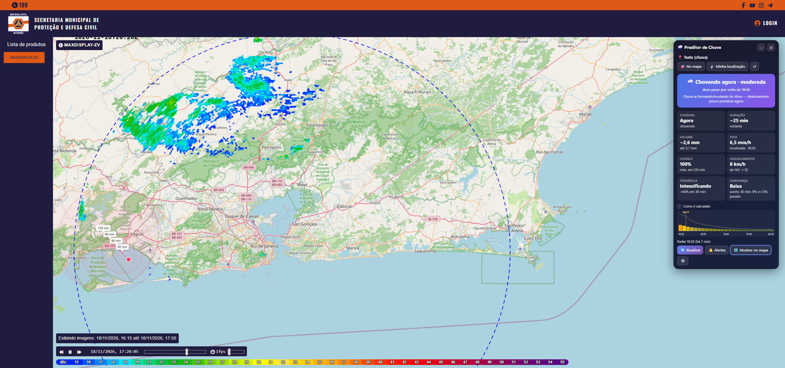

# 🌧️ Radar Niterói Nowcast

Userscript que prevê quando a chuva chega a um ponto escolhido, quanto tempo dura e quanto chove, usando o radar meteorológico de Niterói (https://radar.niteroi.rj.gov.br/).

## Instalação

1. Instale o [Violentmonkey](https://violentmonkey.github.io/) (Edge/Chrome/Firefox) ou o Tampermonkey.
2. Abra o link de instalação direta: https://raw.githubusercontent.com/marco-jardim/radar-niteroi-nowcast/main/radar-niteroi-nowcast.user.js — a extensão oferece a instalação.
3. Abra https://radar.niteroi.rj.gov.br/.

As atualizações são automáticas, via `@updateURL` do cabeçalho do script.

> Se você usou a v1, substitua ou apague o script antigo para que os dois não rodem juntos.

## O que mostra

- **Chegada**: hora e "em N min".
- **Duração** da chuva.
- **Volume provável** e **máximo plausível** (mm).
- **Pico**: mm/h e classe.
- **Chance** de chuva.
- **Deslocamento**: velocidade e direção.
- **Tendência**.
- **Confiança**, com o acerto dos últimos 30 min.
- **Gráfico** de 0–2 h.
- **Trajetória** desenhada no mapa (marcas a cada 30 min até o horizonte).

## Recursos

- Escolha do local clicando no mapa, por GPS, ou volta para Icaraí.
- Alertas do navegador, com antecedência e chance mínima configuráveis.
- Prefixo "(🌧 25min)" no título da aba.
- Painel arrastável e minimizável.
- Configurações persistentes: horizonte de 60–180 min e limiar de 15/20/25 dBZ.
- Atualização automática a cada minuto, baixando apenas imagens novas.
- API no console:
  - `RainPredictor.setTarget(lat, lon, "Nome")`
  - `RainPredictor.run(true)`
  - `RainPredictor.getLastResult()`
  - `RainPredictor.debug()`
  - `RainPredictor.selfTest()`
  - `RainPredictor.hindcast(30)`

## Como funciona

1. Descobre os ids de radar e produto e o mapa de cores pela API pública (`/radars`, `/radars/product-types`, `/radars/{id}/products`).
2. Converte cada PNG em uma grade de dBZ com ~0,86 km por célula (média em blocos no Z linear, georreferenciamento Web Mercator) e mascara ecos estáticos (clutter).
3. Estima o movimento por block matching exaustivo em grades suavizadas, nos últimos ~30 min (pares com 10 min de intervalo), combinados em uma superfície de custo normalizada com peso maior para os pares recentes. A incerteza vem da dispersão entre os pares.
4. Extrapola de forma semi-Lagrangiana até o ponto, de 5 a 120 min, com uma vizinhança cujo raio cresce com o tempo de antecedência. Resultam probabilidade, taxa média e percentil 90.
5. Converte Z = 200·R^1,6 (Marshall–Palmer) em mm/h. Classes: < 2,5 fraca; 2,5–10 moderada; 10–50 forte; ≥ 50 muito forte.
6. Faz um hindcast automático de 30 min (CSI da advecção contra a persistência). Se a extrapolação perde, a confiança cai e a incerteza aumenta.

## Limitações

- A extrapolação não prevê chuva que se forma ou se dissipa no próprio lugar (convecção no fim da tarde), e a qualidade cai após ~60 min.
- O produto MAXDISPLAY-ZV é um máximo de coluna: os mm são uma ordem de grandeza, não uma medida de pluviômetro.
- A precisão é limitada ao alcance de 100 km do radar.
- Os alertas só funcionam com a aba aberta.
- Depende da API não oficial do site, que pode mudar.

## Aviso

Projeto não oficial, sem vínculo com a Prefeitura de Niterói nem com a Defesa Civil. As estimativas são informativas e não substituem os avisos oficiais. Em emergências, ligue para a Defesa Civil: 199.

## Licença

[MIT](LICENSE)
